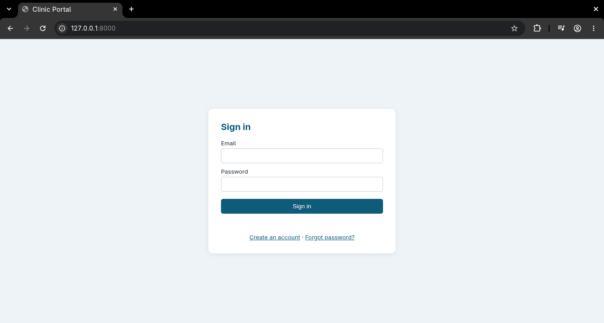
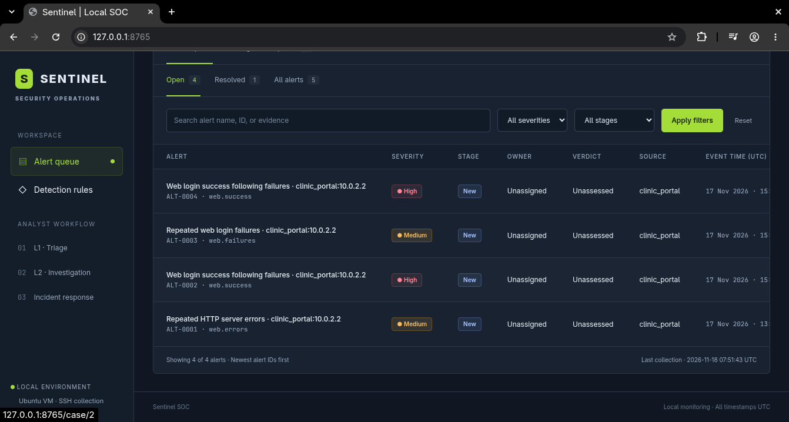

# I built a SIEM, attacked my own lab, and discovered my SIEM couldn't detect me.

## the plan

okk

the plan in my mind is simple  
build a vulnerable machine, pentest it or hack it if ya want it to sound cool

but building a vulnerable by my own would be fun but then pentest would not be fun  
so i relied on my AI agent to build the machine

> **Clinic Portal**
>
> A web CTF set around a fictional clinic’s online portal. Explore the application, assess its security, and investigate the activity it produces through your SOC.
>
> Broad tags: Web Application · Healthcare · CTF · Log Analysis.

this is all the info provided, the next thing was setting up SIEM

## setting up SIEM

i couldn't use wazuh or splunk due to my hardware limits  
so I made custom one with again AI

- **Backend** — Python, Flask, and Waitress.
- **Database** — SQLite stores events, alerts, accounts, case notes, and audit history.
- **Frontend** — Server-rendered HTML/Jinja, CSS, and JavaScript for the alert queue and JSON viewer.
- **Collection** — Every 30 seconds, a restricted SSH account reads Ubuntu’s journal and the CTF’s JSON logs. Journal cursors and file offsets track new events.
- **Detection** — Python rules inspect events and correlate activity by source, IP, and time. Currently 16 rules, with duplicate suppression.
- **Workflow** — Separate L1, L2, and IR accounts, with role checks, password hashing, and CSRF protection. Alerts move through triage → investigation → response → closure.
- **Response** — A separate SSH account runs restricted evidence-collection and temporary IP-blocking commands. Response stays manual.
- **Hosting** — Runs on your main host at `127.0.0.1:8765` as a temporary user service.

okk now, we can start

## now lets solve the ctf

okeh  
its a login page

there are many attack vectors  
so lets start exploring

XSS doesn't work

editing the role to admin didnt work

so lets try sqli

didnt go so well either

lets try the calendar feature

okeh  
it works,

but before that i was able to find an SQL injection

### admin access

we(i) got in

the admin has litrally no priviledge except making other admins

but hey, we got admin acces, now i will invsestiagate the events via SIEM

## checking the SIEM

as an l1, there are four alert. i tested one false positive alert to check if UI worked properly

lets check this one first

> Web login success following failures

this was me, forgetting my account password during pentest

the detectiong rules suck, ill make better rules in the next session

as all the alerts are false positive, and it didnt even detect the SQLi

so thats it for now
